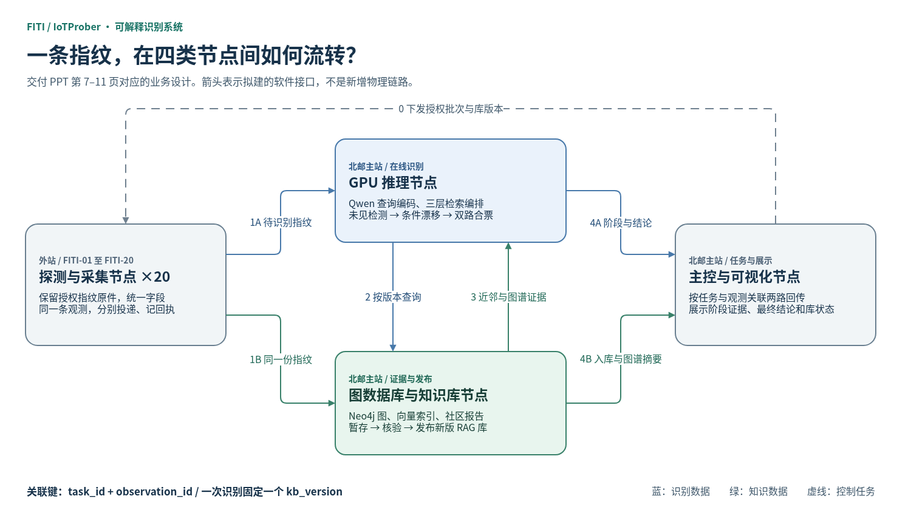

# IoTProber 在 FITI 的四节点对接（公开版）

同一条授权指纹观测要回答两个不同的问题：**推理节点识别出了什么，知识库是否接收了这条观测？** 主控分别记录两路回执，不能把“识别完成”当成“已入库”。本页保留这部分对接约定；不包含站点登录表、交付 PPT 或可用于连接实际节点的配置。

[查看可编辑拓扑图](figure/fiti-iotprober-topology.drawio) · [节点交付空白模板](nodes.example.md)

| 角色 | 接收什么 | 交付什么 |
| --- | --- | --- |
| 探测与采集 | 已获授权的指纹观测 | 保留原始记录，将同一份标准指纹分别交给推理节点和知识库，并分别记录回执。 |
| 图数据库与知识库 | 待审核的观测；指定库版本的检索请求 | 从指定快照返回证据；先暂存新观测，人工核验后才发布新库版本，不原地改写已有快照。 |
| GPU 推理 | 待识别指纹及本次使用的 `kb_version` | 局部模式返回近邻候选，不是最终分类。完整模式结合局部、社区和路径证据给出判定，并把阶段结果回传主控。 |
| 主控与可视化 | 任务以及知识库、推理节点各自的回执 | 按 `task_id` 和 `observation_id` 关联两路结果，分别展示识别结论和入库状态。 |

## 如何核对一次交接

1. 用一条已获授权的离线样本做联调。核对任务号、观测号，以及两路回执中的 `fingerprint_sha256`；只有哈希一致，才是同一份输入。
2. 固定一次识别使用的 `kb_version`。另一时间或另一站点的观测使用新观测号；不要用一次重试覆盖另一条观测。
3. 若只有一路回执，保留原记录，用相同标识和内容重试。核对重复提交没有新增记录，主控也没有把未回执的一路标成完成。

本目录是文档交付，不含 FITI 服务实现或站点配置。IoTProber 的模型及依赖见[项目说明](../readme.md)。如完整推理会把指纹和证据发给模型端点，应先确认该端点获准处理这些数据。

## 论文与数据

- [CP-IoT 论文](paper/CP-IoT.pdf)
- [IoTProber 论文](https://huggingface.co/datasets/IoTProber/raw_dataset/blob/main/IoTProber.pdf)和[原始数据集](https://huggingface.co/datasets/IoTProber/raw_dataset/tree/main)保留在 Hugging Face，本目录不再存一份。
