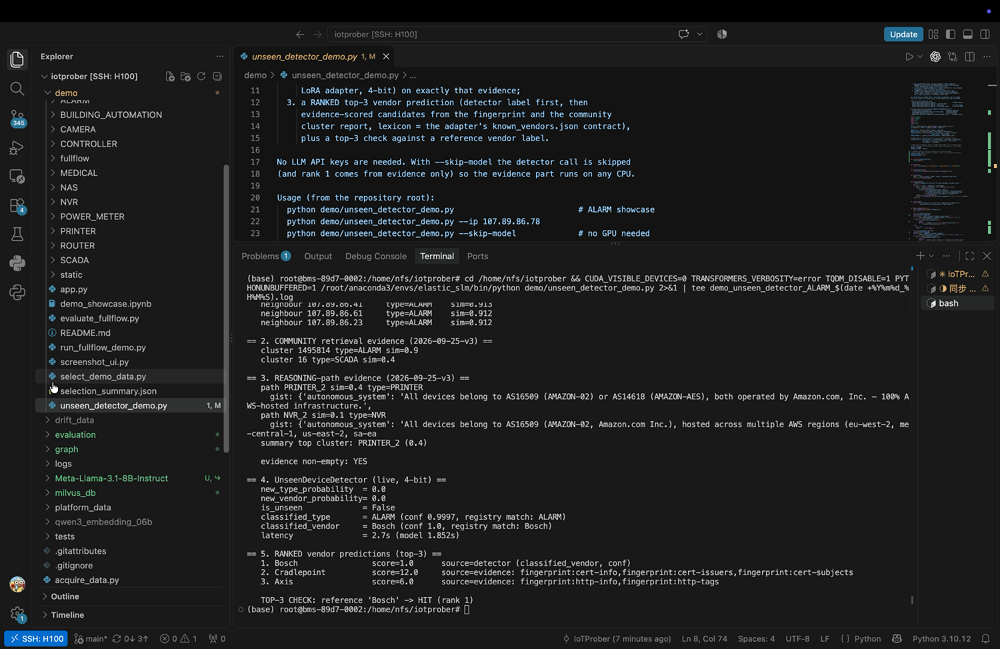

# IoTProber Demo — Minimal Showcase for 11 Device Types

## 单 IP 识别工作台（GPU 忙时使用）

从项目根目录运行 `CUDA_VISIBLE_DEVICES="" python -m demo.workbench.app --port 8765`，使用已安装项目依赖和 Flask 的环境。
服务仅监听 `127.0.0.1`，不占用 GPU。**在本地电脑**运行 `ssh -N -o ExitOnForwardFailure=yes -L 127.0.0.1:8765:127.0.0.1:8765 H100`（其他服务器替换 SSH 别名），保持终端打开，然后访问 <http://127.0.0.1:8765>。
若本地端口已占用，把冒号前的本地 `8765` 改成 `8766`，并在浏览器访问 `8766`。不要启动旧的 GPU 演示来替代此入口。
归档无需登录。为防共享服务器上的其他用户占用 CPU 或消耗 API 额度，实时任务需解锁一次：在启动服务的 SSH 账号下执行 `cat ~/.cache/iotprober-workbench/live.key`，把口令贴到工作台。该文件仅所有者可读，不是 API 密钥。

- **归档回放**无需模型、联网或凭据。默认展示局部 Top-1 和最终类型均与参考标签一致的实例，可切换为全部记录或误判复盘。完全相同指纹的单独检索附档会标注来源，不宣称与旧决策同次运行。精选不用于评估。
- **资产识别**接受一个 IPv4/IPv6 地址，以及 UTF-8 的 JSON/CSV。支持项目字段（如 `hw-products`、`hw-vendors`、`service-distribution`）、Censys `result.resource`、`result.hits[].host_v1`。多行数据必须含唯一匹配的 IP；不会连接输入的设备。
- **Censys 来源**只向 Platform `Get a host` 查询该授权公网 IP。PAT 可在页面逐次输入，或由服务器设置 `CENSYS_PERSONAL_ACCESS_TOKEN`、可选 `CENSYS_ORG_ID`；也兼容 `acquire_data.py` 使用的 `search_config.json` 的 `censys.platform` 配置。不要提交密钥文件。无凭据时仍可上传指纹。
- **快速本地**仅运行 CPU Qwen 与 NumPy 知识库检索，报告近邻候选，不调用 LLM、不宣称识别了厂商。**完整识别**在逐次确认后调用配置的 LLM，并运行 CPU Llama + LoRA 与条件 PACA 检测；三个检索层、第一阶段、双分支和最终类型/厂商分开展示。与 GPU 量化模式的数值不保证一致。
- 运行前配置模型和只读索引路径（见 `path_config.py`）。限一个低优先级单线程计算任务；每次使用独立临时目录，结束时释放模型，不写知识图或共享预测缓存，不启动 Tavily。启动或查看页面不会预加载模型。
- 完整模式首次命中一个知识库噪声成员时生成一份报告，之后直接读取；每次用该成员本次的局部余弦比对，不重复调用 LLM。单成员不能当作群体证据。成功的库成员报告默认落在服务账号的 `~/.cache/iotprober-workbench/knowledge-reports/`，不含本次查询指纹；其他运行默认放在 `QUERY_DB_DIR/singleton_reports`，也可设置 `IOTPROBER_SINGLETON_REPORT_DIR`。快速本地与归档模式不生成报告。
- 可在项目根目录用 `python -m agent.singleton_reports --types CAMERA --limit 5 --cache-dir ~/.cache/iotprober-workbench/knowledge-reports` **只检查**准备情况，不发请求；经授权加 `--allow-llm` 才为缺失的报告调用 LLM，最多处理每类指定数量的成员，不改社区分配或已有归档。

For each of the 11 RAG device types defined in `config/rag_devices.json`, 40 validation cases are selected with a fixed random seed after the exclusions below (POWER_METER has 38 eligible cases). The complete, unranked set is stored in `validation_cases.json` and is the default input to the full-pipeline evaluation.

The v2 adapter (`UnseenDeviceDetector._build_aligned_prompt → _generate_classification → _classification_novelty_result`) is run over this complete set. A separate `cases.json` contains three curated, correctly classified UI examples. Those curated examples are not used to report retrieval accuracy.

## Three-Stage Candidate Pool Filtering

Before reviewing the rankings, it is important to understand how the demo candidate pool is filtered:

1. **Training/validation IP exclusion** (65,027 IPs) — otherwise the demo would measure memorization rather than recognition.
2. **Cross-type duplicate IP exclusion** (15,346 IPs) — the same fingerprint appears in multiple device-type files with conflicting labels.
3. **Generic cloud host exclusion** (approximately 8,900 rows) — AWS, GCP, Azure, and similar hosts are identified through `dns-reverse`, `as-name`, and `whois`; at one point, 85% of the POWER_METER corpus consisted of AWS EC2 hosts.

Candidate-pool accuracy after filtering (40 candidates per type unless otherwise noted):

| Device Type | Correct | | Device Type | Correct | | Device Type | Correct |
|---|---|---|---|---|---|---|---|
| ALARM | 40/40 | | CONTROLLER | 40/40 | | NVR | 40/40 |
| POWER_METER | 38/38 | | MEDICAL | 39/40 | | NAS | 39/40 |
| SCADA | 39/40 | | BUILDING_AUTOMATION | 38/40 | | PRINTER | 37/40 |
| CAMERA | 36/40 | | ROUTER | 34/40 | | | |

> In this demo, a result is considered "correct" when it matches the directory label in the ipraw corpus. The corpus labels themselves contain noise, including cross-type duplicates and mislabeled cloud hosts; filters 2 and 3 above are intended to remove as many of these samples as possible.
> CONTROLLER has fewer than 40 rich-fingerprint samples, so its candidates are drawn from the full dataset and marked as `rich_filter_bypassed` in `selection_summary.json`.

## Directory Structure

```
demo/
├── {TYPE}/cases.json            # Curated UI cases: fingerprint + classification + novelty + drift (+ CAMERA vector neighbors)
├── {TYPE}/validation_cases.json # Complete fixed-seed random validation set; never post-filtered by correctness
├── selection_summary.json       # Pool size, exclusions, correct count, maximum confidence, and filter fallback for each type
├── select_demo_data.py          # Selection script (--candidates / --rank R / --merge, sharded across eight GPUs)
├── run_fullflow_demo.py          # Complete three-level retrieval + decision evaluation over the random set
├── evaluate_fullflow.py          # Integrity, availability, retrieval, accuracy, and calibration metrics
├── demo_showcase.ipynb          # Executed minimal showcase notebook with charts
├── app.py + static/index.html   # Local visualization web interface
├── screenshot_ui.py             # Optional headless-browser screenshots for visual regression testing
└── README.md
```

## Environment Requirements

| Task | Environment | Reason |
|---|---|---|
| View the notebook or open the web interface | `iotprober` | Only pandas, matplotlib, and Flask are required. |
| **Online classification** (`/api/classify`) | **`elastic_slm`** | Uses the same PyTorch/Transformers numerical environment that generated `cases.json`, making the results comparable. |
| **Run selection again** (`select_demo_data.py`) | **`elastic_slm`** | The script imports the training code and depends on `datasets`, which is not installed in the `iotprober` environment. |

```bash
EL=/root/anaconda3/envs/elastic_slm/bin/python     # Inference and selection
IO=/root/anaconda3/envs/iotprober/bin/python       # Web interface and notebook only
```

## Usage

```bash
# 1) Notebook (static showcase; no GPU required)
cd demo && $IO -m jupyter nbconvert --to notebook --execute --inplace demo_showcase.ipynb
#    Alternatively, open the already-executed demo_showcase.ipynb directly.

# 2) Web interface → http://localhost:5001
cd demo && $EL app.py
#    "Online Classification" loads the v2 adapter on demand. In testing, it used
#    approximately 8.7 GB of VRAM on one GPU and took about one minute on first load.
#    The classification result matches the stored result, while confidence may differ
#    by approximately 1e-5 because of floating-point nondeterminism in 4-bit inference.
#    GPU 0 is used by default; the detector pins the quantized base to the selected GPU.
#    DEMO_GPU=3 $EL app.py
#    IOTPROBER_UNSEEN_BITS=8 IOTPROBER_UNSEEN_ADAPTER=/path/to/final_model $EL app.py

# 3) Run selection again (only needed when the corpus changes)
#    Prerequisites that are easy to overlook:
#      · /dev/shm/ipraw/ipraw_{TYPE}.csv  ← Raw fingerprints for 11 device types,
#        approximately 8.4 GB in tmpfs and lost after a reboot.
#        Rebuild by downloading with:
#        hf_hub_download('IoTProber/raw_dataset', 'platform_data/csv/rag/ipraw_files.tar.gz',
#                        repo_type='dataset')
#        and then extracting the archive to /dev/shm/ipraw.
#      · /dev/shm/demo_select             ← Intermediate candidates.json files,
#        also stored in tmpfs.
#    Run the following three commands in order during the same boot session:
cd demo
$EL select_demo_data.py --candidates                   # Build the candidate pool with all three filters (~5 minutes)
for i in 0 1 2 3 4 5 6 7; do                            # Eight-GPU sharded inference (~2 minutes)
  CUDA_VISIBLE_DEVICES=$i $EL select_demo_data.py --rank $i --world_size 8 &
done
wait
$EL select_demo_data.py --merge                        # Selection + drift + CAMERA neighbors (~2 minutes)

# Materialize/refresh only the unbiased validation files from existing
# /dev/shm/demo_select candidates and predictions (does not touch cases.json):
$EL select_demo_data.py --materialize-validation

# Full three-level evaluation. It resumes only version-compatible per-IP caches,
# keeps failures, and stores local/community/reasoning evidence in every result:
$EL run_fullflow_demo.py
# Use the curated UI cases only when explicitly requested:
$EL run_fullflow_demo.py --showcase-only
```

## Showcase Contents

Each case contains the complete 46-column fingerprint, adapter classification (device type, vendor, two confidence scores, and two novelty probabilities), a PACA drift score (τ=8.7755, loaded from artifacts rather than hard-coded), and vector neighbors for CAMERA cases.

```bash
python - <<'PY'
import json
c = json.load(open('demo/CAMERA/cases.json'))[0]
print(c['ip'], c['result']['classified_type'], c['result']['classified_vendor'], c['result']['type_confidence'])
PY
```

## Unseen Device Detection: ALARM Case Study

This recording demonstrates an ALARM device example with [`unseen_detector_demo.py`](unseen_detector_demo.py), including LOCAL, COMMUNITY, and REASONING-path retrieval evidence, live `UnseenDeviceDetector` inference, and ranked top-3 vendor predictions. The recorded run classifies the device as ALARM and predicts Bosch as the top-ranked vendor, matching the demo's reference vendor label.

[](unseen-demo.mov)

**[Watch or download the demo video](unseen-demo.mov)** (MOV, approximately 79 seconds). Click the preview above to open the recording.

To reproduce the recorded run in `/home/nfs/iotprober` using the `elastic_slm` environment on GPU 0 and save the combined output to a timestamped log:

```bash
cd /home/nfs/iotprober && CUDA_VISIBLE_DEVICES=0 TRANSFORMERS_VERBOSITY=error TQDM_DISABLE=1 PYTHONUNBUFFERED=1 /root/anaconda3/envs/elastic_slm/bin/python demo/unseen_detector_demo.py 2>&1 | tee demo_unseen_detector_ALARM_$(date +%Y%m%d_%H%M%S).log
```
